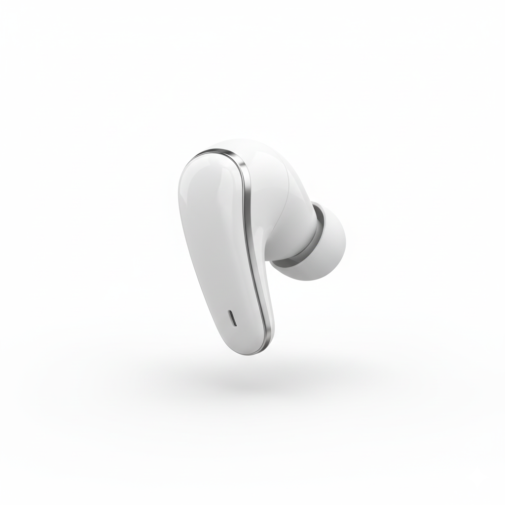

# FIKRA.LABS | Premium E-Commerce Template

 <!-- Update this with a real screenshot of the app -->

A highly polished, stealth-themed Next.js e-commerce template designed for premium brands. It features a sleek glassmorphism UI, interactive product cards with custom SVG "electric" borders, and a seamless shopping cart experience.

## ✨ Features

* **Stealth & Premium UI:** Deep dark mode aesthetic with carefully crafted silver/metallic highlights and glassmorphism panels.
* **Electric Border Cards:** Custom SVG turbulence filters to create dynamic, animated border effects on product cards.
* **Hero Marquee:** Infinite scrolling, interactive product showcase hero section.
* **Global Shopping Cart:** Slide-out, holographic-styled cart with persistent global state.
* **Quick View Modals:** Instantly view product details without leaving the current page context.
* **Category Filtering:** Seamless front-end product filtering with a dedicated sidebar.
* **Next.js 15 & React 19:** Built on the bleeding edge of the React ecosystem.

## 🚀 Tech Stack

* **Framework:** Next.js 15 (App Router)
* **Library:** React 19
* **Styling:** Tailwind CSS 4 (via `@tailwindcss/postcss`)
* **3D/Graphics:** `@react-three/fiber` & `@react-three/drei`
* **Icons:** `lucide-react`
* **State Management:** React Context API (`ShopContext`)

## 🛠️ Getting Started

First, clone the repository and install dependencies:

```bash
npm install
# or
pnpm install
```

Run the development server:

```bash
npm run dev
# or
pnpm run dev
```

Open [http://localhost:3000](http://localhost:3000) with your browser to see the result.

## 📂 Project Structure

* `/app` - Next.js App Router pages and layouts
* `/components` - Reusable UI components (Cards, Modals, Navbars)
* `/contexts` - Global state context (e.g., `shop-context.tsx`)
* `/public/images` - Static assets for products

## 🎨 Customization

The core theme is controlled via CSS variables in `/app/globals.css`. You can easily adjust the `var(--background)`, `var(--foreground)`, and `var(--electric-light-color)` to match your brand identity.

## 📄 License

This project is open-source and available under the [MIT License](LICENSE).
